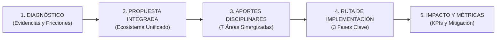
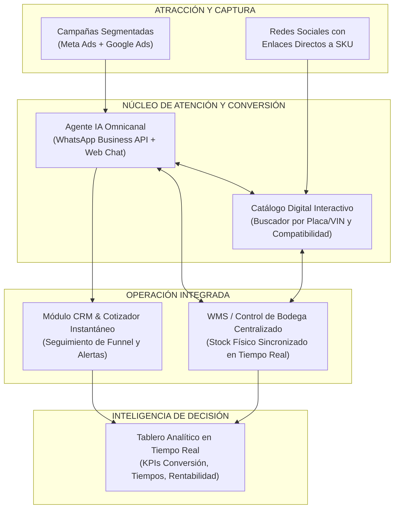
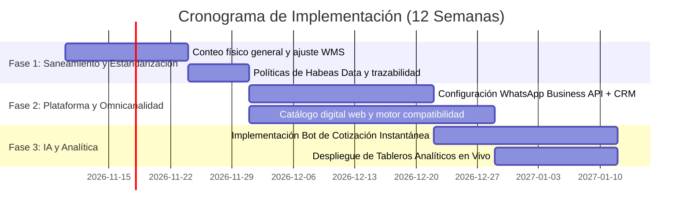

# PÓSTER ACADÉMICO DE SOLUCIÓN INTERDISCIPLINAR
## PROYECTO: AUTO-CONEXIÓN 360° (CARSYSTEM)
**Reto Empresarial Estud-IA: Alcaldía de Medellín · Sapiencia · Esumer**

---

### TÍTULO DE LA PROPUESTA
> **"AutoConexión Carsystem 360°: Transformación Digital del Ecosistema de Búsqueda, Cotización y Suministro de Repuestos mediante Omnicanalidad, Automatización e Integración de Inventario en Tiempo Real"**

---

---

## 1. PROBLEMA Y DIAGNÓSTICO SUSTENTADO

### 1.1. Contexto y Pregunta Reto
*Carsystem* atiende simultáneamente a talleres mecánicos (B2B) y clientes particulares (B2C). Ambos segmentos requieren agilidad crítica para evitar vehículos varados. Sin embargo, la operación actual funciona en silos analógicos y desconectados.

### 1.2. Evidencias Clave del Expediente de Datos

| Dimensión | Evidencia Empírica (Datos Carsystem) | Impacto Operativo y Financiero |
| :--- | :--- | :--- |
| **Pérdida Comercial Crítica** | **54.2% de cotizaciones perdidas** (52 de 96). • Ganadas: tiempo medio respuesta **4.0 h**. • Perdidas: tiempo medio respuesta **8.8 h** (con picos de hasta 20h). | El retraso empuja a los compradores directamente a la competencia (10 casos) o desiste por falta de seguimiento (7 casos). |
| **Cuello de Botella Multicanal** | **204 interacciones en 6 canales dispersos** (WhatsApp 48%, Teléfono 19%, Instagram 18%, etc.). • Tiempo medio 1ª respuesta: **6.4 horas**. • Tiempo medio envío de precio: **8.5 horas**. • 18 derivaciones manuales a WhatsApp y 12 precios dados de palabra sin registro. | Fuga de prospectos calificados, falta de trazabilidad comercial y desgaste del equipo de ventas. |
| **Inconsistencia de Bodega** | **Discrepancia sistemática entre sistema y stock físico**:  • Filtro de aceite MO-201: desfase de **-47 unds**. • Filtro de aire FI-601: **-30 unds**. • Termostato RE-502: **-22 unds**. • Pastillas FR-101: **-16 unds**. | Quiebres de stock "fantasma": se cotizan repuestos inexistentes o se rechazan compras teniendo inventario disponible. |
| **Fricción Postventa (PQR)** | 10 PQRs registradas con tiempos de solución de hasta **6 días hábiles**; 40% asociadas a errores de referencia/compatibilidad vehicular o despacho tardío. | Deterioro de reputación y pérdida de lealtad en talleres recurrentes. |
| **Riesgo Regulatorio y Legal** | **33.3% de clientes** sin autorización de tratamiento de datos personales registrada (Ley 1581 de 2012 / Habeas Data). | Vulnerabilidad legal y sanciones ante la SIC por manejo informal de canales. |

---

## 2. PROPUESTA INTEGRADA: EL ECOSISTEMA "AUTOCONEXIÓN 360°"

La solución transforma el modelo reactivo y fragmentado en una **experiencia digital de punta a punta** compuesta por cuatro componentes articulados:

### Principios de la Solución:
1. **Unificación Omnicanal:** Concentración de WhatsApp, Instagram, Facebook y Web en una única bandeja de entrada empresarial centralizada (evitando canales aislados en teléfonos personales).
2. **Autogestión Inteligente:** Asistente conversacional con IA entrenado sobre el catálogo técnico de repuestos para cotizar de manera automática referencias estándar en menos de 2 minutos.
3. **Sincronización Transparente de Inventario:** El sistema no cotiza nada que no esté validado físicamente en almacén, alertando de antemano fechas de reposición si no hay disponibilidad.

---

## 3. APORTES DE LAS DISCIPLINAS AL PROYECTO

| Disciplina | Contribución Estratégica en Carsystem | Entregables Concretos |
| :--- | :--- | :--- |
| **1. Marketing Digital y Comunidades** | Estrategia de contenidos segmentada por público (Talleres vs. Particulares), redirigiendo tráfico pagado a enlaces con parámetros UTM directos a la cotización de repuestos de alta rotación. | Arquitectura del embudo de ventas, catálogo publicitario y políticas de engagement en WhatsApp Business. |
| **2. E-commerce e Innovación** | Estructuración del catálogo digital con filtrado técnico (Marca, Modelo, Año, Cilindrada, Referencia OEM) y pasarela de pago segura (Wompi/PSE) para compras express. | Wireframes del flujo de compra y especificación de fichas técnicas de producto con garantías claras. |
| **3. Producción de Contenidos** | Creación de guías visuales y audiovisuales de compatibilidad, mantenimiento preventivo y verificación de repuestos originales para reducir dudas y PQRs. | Manuales de producto rápidos, infografías de despiece y videos cortos explicativos. |
| **4. IA y Automatización** | Modelo de procesamiento de lenguaje natural (NLP) conectado a la API de WhatsApp para identificar consultas de repuestos, verificar stock disponible y generar cotizaciones en PDF automáticamente. | Pipeline del bot de cotización, reglas de escalamiento a asesor humano en casos complejos. |
| **5. Desarrollo Web Full Stack** | Plataforma responsiva (Next.js/React + FastAPI/Node) que integra el portal cliente (consulta y seguimiento de cotización) y el portal del asesor/bodega. | Dashboard interactivo de cotizaciones y API REST de consulta de inventario. |
| **6. Cloud y Ciberseguridad** | Infraestructura en la nube escalable (AWS/GCP), cifrado SSL/TLS de extremo a extremo, control de acceso RBAC y módulo de consentimiento explícito de Habeas Data. | Diagrama de arquitectura cloud segura, políticas de backup diario y registro auditable de autorizaciones. |
| **7. Análisis y Visualización de Datos** | Tableros ejecutivos en Power BI / Looker Studio para monitorear en vivo la conversión de cotizaciones, tiempos de respuesta, rotación de SKUs y disparidades de bodega. | Pipeline ETL para los 9 datasets y Dashboard de Control Gerencial con alertas de stock mínimo. |

---

## 4. PLAN Y RUTA DE IMPLEMENTACIÓN

### Detalle de Recursos y Prioridades:
* **Fase 1 (Semanas 1-3) - Base Operativa & Legal:** Ajuste y conteo cíclico de inventario físico para erradicar las discrepancias de stock (`MO-201`, `FI-601`); implementación del protocolo obligatorio de consentimiento de datos en el primer contacto.
* **Fase 2 (Semanas 4-8) - Integración Comercial:** Unificación de canales en CRM comercial compartido; puesta en marcha del catálogo digital con buscador por placa/modelo.
* **Fase 3 (Semanas 9-12) - Automatización e Inteligencia:** Conexión del bot de WhatsApp para cotizaciones automáticas 24/7 y despliegue del tablero de analítica de ventas y alertas de reposición.

---

## 5. IMPACTO ESPERADO, INDICADORES (KPIs) Y GESTIÓN DE RIESGOS

### 5.1. Cuadro de Mando de Impacto

| Métrica / Indicador | Situación Actual (Línea Base) | Meta a 3 Meses | Beneficio Directo |
| :--- | :---: | :---: | :--- |
| **Tiempo promedio de cotización** | **8.5 horas** | **< 10 minutos** (inmediato con Bot) | Aumenta drásticamente la probabilidad de ganar la venta. |
| **Tasa de conversión de cotizaciones** | **45.8%** (54% perdidas) | **> 70%** | Incremento directo de ingresos sin aumentar el gasto en pauta. |
| **Discrepancia de inventario (Stock Accuracy)** | **Descuadres de hasta -47 unds** | **< 2% de diferencia** | Elimina cancelaciones por falta de producto físico. |
| **Tasa de resolución de PQRs** | **Hasta 6 días hábiles** | **< 24 horas** | Retención y fidelización de talleres mecánicos aliados. |
| **Cumplimiento legal Habeas Data** | **66.7% autorizado (33% no reg.)**| **100% verificado** | Blindaje contra multas y sanciones regulatorias. |

### 5.2. Matriz de Riesgos y Mitigación

* **Riesgo 1: Resistencia al cambio del personal de ventas y bodega.**
  * *Mitigación:* Programa de capacitación gamificada enfocado en cómo la automatización les ahorra tareas repetitivas y les ayuda a comisionar más al cerrar ventas más rápido.
* **Riesgo 2: Respuestas erróneas del bot sobre compatibilidades complejas.**
  * *Mitigación:* Filtro estricto: el bot solo cotiza piezas estándar verificadas por catálogo; cualquier repuesto complejo se escala de inmediato con ficha prellenada al asesor especializado.
* **Riesgo 3: Costos imprevistos de infraestructura en la nube.**
  * *Mitigación:* Uso de arquitecturas *Serverless* de bajo costo y niveles gratuitos o modelos de pago por uso adaptados al volumen operativo de Carsystem.

---

## 6. CONCLUSIÓN Y VALOR DIFERENCIAL

> *"La transformación de Carsystem no consiste simplemente en adquirir más tecnología aislada, sino en orquestar armónicamente a las personas, los datos y los canales. Al cerrar la brecha entre el inventario de bodega y el tiempo de respuesta al cliente, Carsystem pasará de ser un mostrador tradicional que pierde más de la mitad de sus oportunidades a un ecosistema comercial ágil, confiable y líder en repuestos automotrices."*

